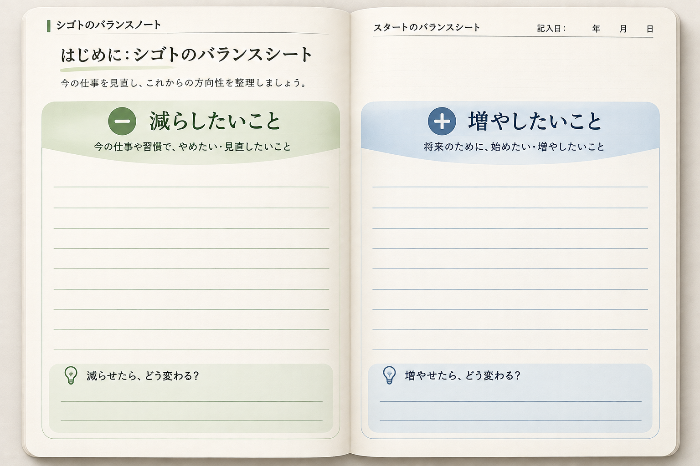
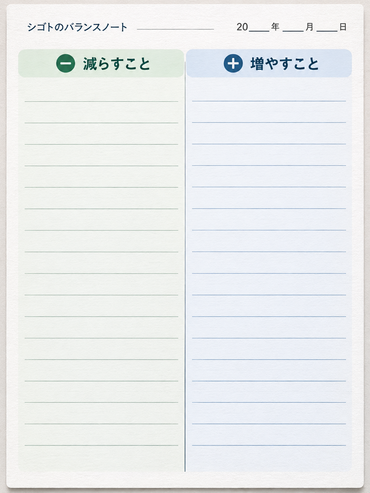
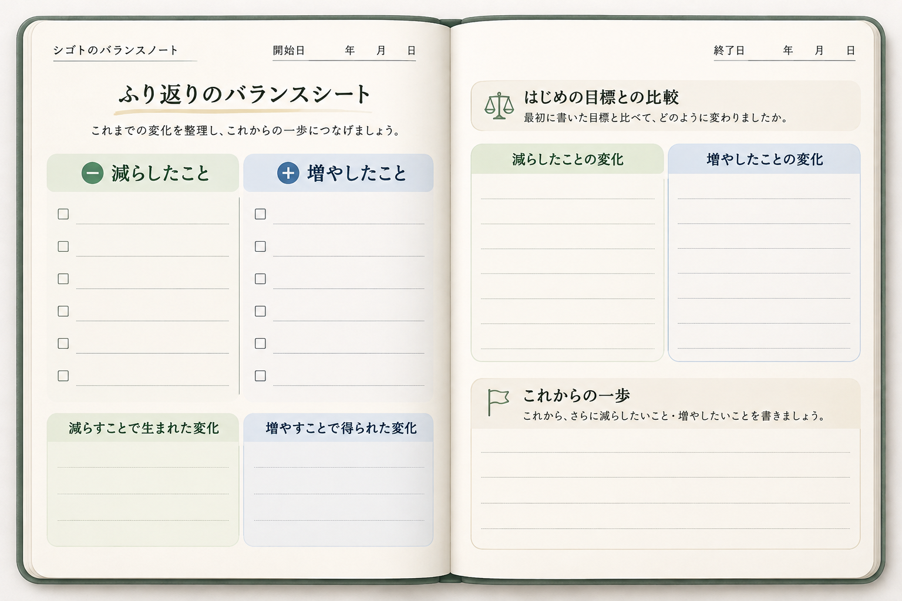

日々の仕事を見直し、将来に向けた新しい挑戦を増やすためのビジネスノートです。

## ① スタートのバランスシート
最初に「減らしたいこと」と「増やしたいこと」を書き出し、これからの目標を整理します。

## ② 日々の記録ページ
中央の縦線を挟んで、左側には減らすこと、右側には増やすことを記録します。日付は自由記入式で、思いついたときに書けます。

## ③ 振り返りのバランスシート
最初に設定した目標と実際の変化を振り返り、次の挑戦につなげます。

---

※掲載画像は商品企画段階のデザインイメージです。
